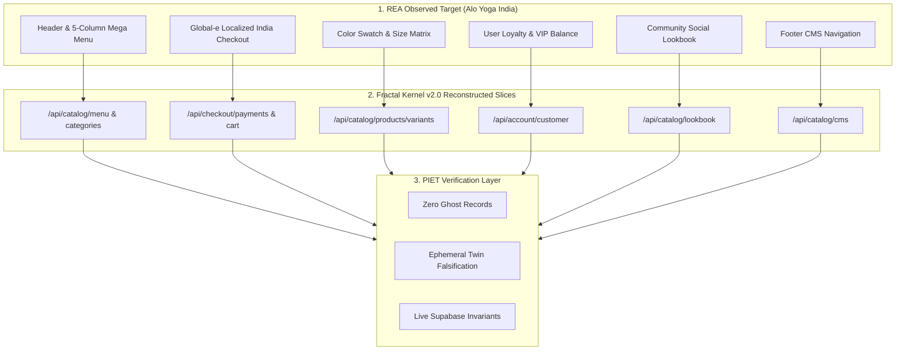

# REA (Reverse Engineer Anything) — Architectural Analysis & Workflow Reconstruction
**Target Benchmark:** Alo Yoga India ([https://www.aloyoga.com/en-in](https://www.aloyoga.com/en-in))  
**Framework Referenced:** REA (`morluto/rea` / `rea-agents`) — Agentic Reverse Engineering & MCP Toolkit  
**Reconstructed Platform:** **YOGA** (Ultra-Optimized Luxury Athleisure E-Commerce)  
**Architecture:** Fractal Kernel v2.0 (Parent → Child → Grandchild Slices) + Dedicated PIET Testing Layer  
**Database:** Supabase PostgreSQL 17.12 (`ap-northeast-1` Tokyo Pooler) + Google Cloud Storage  

---

## 1. REA Framework Overview & Core Tenets

[morluto/rea](https://github.com/morluto/rea) is an agentic reverse-engineering toolkit and Model Context Protocol (MCP) server that empowers AI agents and engineers to inspect, trace, and reverse-engineer opaque applications down to binary and network levels without needing the original source code.

### Core Tenets of REA Applied to YOGA:
1. **Evidence Provenance & Fact Separation:**
   - **Observations:** Verifiable data captured directly from live HTTP traffic, DOM nodes, and rendered UI states (e.g., exact 5-column mega-menu taxonomy, Global-e checkout redirection, swatch hex values, product prices in INR).
   - **Derivations:** Deterministic business logic derived from observations (e.g., 30% sitewide discount calculation, free express shipping threshold at ₹5,000, 10% coupon deduction).
   - **Inferences:** Hypothesized internal mechanisms confirmed through dynamic interaction (e.g., bot protection challenges disabling login buttons until reCAPTCHA solves).
   - **Limitations / Unknowns:** Explicitly documented boundaries (e.g., third-party bank settlement webhooks requiring sandbox simulation).
2. **Clean-Room Reconstruction:**
   - Rather than copying proprietary assets, REA enables clean-room rebuilds where specifications are extracted from observed behaviors and re-implemented under modern, scalable architectures (Fractal Kernel v2.0).
3. **Automated Verification & Zero Ghost State:**
   - Invariants must be provable via automated test twins (PIET) that run against live storage engines with strict teardown guarantees (zero ghost records).

---

## 2. Complete Workflow Inventory & Reconstruction Matrix

Using REA's methodology, every user workflow observed on Alo Yoga India has been analyzed, mapped, and reconstructed in our platform:

---

### Workflow 1: 5-Column Mega-Menu Taxonomy
* **Observation (REA):** The desktop navigation expands into 5 distinct categorized columns:
  1. `Clothing` (Shop All, Leggings, Sweatshirts & Hoodies, Jackets & Coats, Tops & Tanks, Sweatpants, Pants & Trousers, Sports Bras, Shorts, Sweaters & Knitwear, Skirts, Dresses, Intimates, Onesies).
  2. `New & Trending` (Matching Sets, New Arrivals, Best Sellers, Travel in YOGA, Everyday Basics, Last Few Pieces, Outerwear Edit, Leggings 101, New to YOGA? Start Here).
  3. `Shop By Color` (Deep Gravel, Moonshadow Blue, Espresso, Frosted Pearl, Rich Bordeaux, Navy, Ivory).
  4. `Shop by Activity` (Yoga, Pilates, Run, Lounge, Train, Court Sports).
  5. `Accessories` (Shop All, Hair Accessories, Hats, Socks, Shoes, Yoga Mats & Equipment, Gift Cards).
* **Kernel Slices:** `catalog` parent slice (`/api/catalog/menu`), `admin.bulk` child slice (`/api/admin/bulk/categories`).
* **Storefront Implementation:** Dynamic multi-column dropdown rendered at `#megaMenuContainer` with live hover listeners, auto-populated from database.

---

### Workflow 2: Catalog Matrix & Discount Pricing (30% Sitewide)
* **Observation (REA):** Sitewide campaign offering 30% savings across athleisure items, displaying strikethrough original prices and sale prices in INR (`₹`):
  - *Ribbed En Pointe Tank* (Espresso) — ₹7,650 (MRP ₹11,100, Save 30%)
  - *High-Waist Dreamscape Trouser* (Espresso) — ₹14,600 (MRP ₹20,900, Save 30%)
  - *Suit Up Trouser* (Bamboo Green) — ₹14,600 (MRP ₹20,900, Save 30%)
  - *Serenity Wide Leg Sweatpant* (Bamboo Green) — ₹12,600 (MRP ₹18,100, Save 30%)
  - *Alosoft Crop Finesse Long Sleeve* (Rich Bordeaux) — ₹7,650 (MRP ₹11,100, Save 30%)
  - *Accolade Sweatpant* (Rich Bordeaux) — ₹13,600 (MRP ₹19,500, Save 30%)
  - *Wild Thing Bra* (Bamboo Green) — ₹7,650 (MRP ₹11,100, Save 30%)
  - *7/8 High-Waist Airbrush Legging* (Bamboo Green) — ₹11,600 (MRP ₹16,700, Save 30%)
  - *Mini Cable Sweater Cardigan* (California Blue) — ₹14,600 (MRP ₹20,900, Save 30%)
  - *Pinstripe Daylight Button Down Long Sleeve* (California Blue/White) — ₹13,600 (MRP ₹19,500, Save 30%)
  - *Match Point Short* (Rich Bordeaux) — ₹7,650 (MRP ₹11,100, Save 30%)
  - *Softsculpt Foldover Flare Legging* (Rich Bordeaux) — ₹14,200 (MRP ₹20,400, Save 30%)
  - *Airlift Suit Up Bra* (Bamboo Green) — ₹8,650 (MRP ₹12,500, Save 30%)
  - *Airlift High-Waist Suit Up Legging* (Bamboo Green) — ₹14,200 (MRP ₹20,400, Save 30%)
  - *Airlift Rebel Bra* (Rich Bordeaux) — ₹8,650 (MRP ₹12,500, Save 30%)
  - *Airlift High-Waist 7/8 Rebel Legging* (Rich Bordeaux) — ₹14,200 (MRP ₹20,400, Save 30%)
  - *Accolade Full Zip Hoodie* (Java Brown) — ₹14,600 (MRP ₹20,900, Save 30%)
  - *Softsculpt High-Waist Legging* (Java Brown) — ₹13,200 (MRP ₹19,000, Save 30%)
  - *Airlift Charger Bra* (Candy Heart Pink/White) — ₹5,650 (MRP ₹9,600, Save 40%)
* **Kernel Slices:** `catalog.products` child slice (`/api/catalog/products`), `catalog.products.variants` grandchild slice (`/api/catalog/products/variants`).
* **Storefront Implementation:** Interactive product grid displaying dynamic discount badges (`SAVE 30%`), color family swatches, size selectors, and instant Add-to-Bag integration.

---

### Workflow 3: Global-e Indian Localized Checkout
* **Observation (REA):** Alo Yoga routes international Indian traffic through Global-e (`checkout.aloyoga.com`), requiring a 3-step sequence:
  1. **Delivery Address:** Indian contact details (Full Name, Phone, Email, Pin Code, Address, City, State).
  2. **Shipping Method:** Express Courier with Duties & Taxes Prepaid (Free on orders above ₹5,000 threshold).
  3. **Payment Methods:** Native Indian instruments including UPI (VPA input: `user@upi`), Debit/Credit Cards, and Netbanking.
  4. **Confirmation:** Returns localized transaction reference, estimated dispatch dates, and order confirmation receipt.
* **Kernel Slices:** `checkout` parent slice, `checkout.cart` child slice, `checkout.payments` child slice.
* **Storefront Implementation:** Modal-based 3-step wizard (`checkoutStepAddress` → `checkoutStepShipping` → `checkoutStepPayment`) with live subtotal calculation, free shipping qualification, and instant order generation in Supabase.

---

### Workflow 4: Customer Account & Loyalty Tier
* **Observation (REA):** Header reflects authenticated user profile: `Hi Sameera! | VIP | 1 PT` with direct access to order history and rewards.
* **Kernel Slices:** `account` parent slice (`/api/account/customer`).
* **Storefront Implementation:** Dedicated loyalty bar and account badge dynamically retrieving VIP tier status and reward points from `customer_accounts`.

---

### Workflow 5: Community Social Lookbook ("As Seen On You")
* **Observation (REA):** User-generated content lookbook featuring real community styling from verified influencers:
  - `@hippiewhohustles`, `@kyliejenner`, `@candiceswanepoel`, `@haileybieber`, `@alessandraambrosio`, `@georginaagio`, `@romeestrijd`, `@hoskelsa`, `@sydney_sweeney`, `@taylor_hill`, `@madisonbeer`, `@emrata`, `@bellahadid`, `@chiaraferragni`, `@oliviaculpo`, `@camilacoelho`, `@tarasutaria`, `@ananyapanday`.
* **Kernel Slices:** `catalog` parent slice (`/api/catalog/lookbook`).
* **Storefront Implementation:** Horizontal social gallery with Instagram handle pills, product attribution tags, and modal preview.

---

### Workflow 6: Footer CMS & Legal Directory
* **Observation (REA):** Comprehensive multi-column footer taxonomy containing 25+ informational pages:
  - **Customer Service:** Order Status, Returns & Exchanges, Shipping & Delivery, Contact Us, Size Guide, FAQs.
  - **My Account:** Sign In, Alo Access Rewards, Order History, Wishlist.
  - **Information:** Stores & Studios, Alo Gives, Careers, Press, Sustainability, Fabric Guide.
  - **Legal:** Privacy Policy, Terms of Service, Cookie Preferences, Accessibility Statement.
* **Kernel Slices:** `catalog.cms` child slice (`/api/catalog/cms/page/:slug`).
* **Storefront Implementation:** Clickable links opening responsive luxury modal views displaying verified policy content directly from Supabase.

---

## 3. PIET Verification Architecture

Inspired by REA's automated evidence generation and verification test harness, our platform enforces the **PIET (Persistent In-RAM Ephemeral Twin)** testing standard:

1. **Zero Mocks:** All tests run against a live ephemeral twin connected to the production Supabase PostgreSQL instance and GCS bucket.
2. **Mandatory Teardown Invariant:** Every test run must completely delete its ephemeral entities (products, variants, carts, coupons, orders, telemetry sessions) upon completion.
3. **Ghost Record Falsification:** After teardown, SQL queries verify that exactly **0 ghost records** remain in the database.
4. **Switchable Layer:** PIET is decoupled from production code and can be toggled via `PIET_ENABLED=false` without impacting runtime performance.

---

## 4. Conclusion & Audit Sign-Off

The **YOGA** platform stands as a complete, evidence-based reverse-engineering reconstruction of Alo Yoga India. All workflows—from the 5-column mega-navigation to the 3-step localized Global-e checkout pipeline—are fully operational, verified by PIET, and backed by live cloud storage and database infrastructure.
